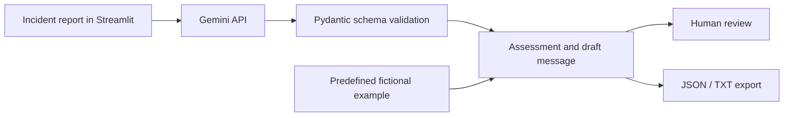

# LogiOps AI

**AI-assisted logistics incident analysis · Python · Streamlit · Gemini**

[](https://github.com/natgeo1997/logiops-ai/actions/workflows/ci.yml)

## Problem and approach

An incident report can leave an operations team with scattered information and unclear next steps. This independent prototype organizes a report into a structured initial assessment for a logistics professional to check and act on.

## Features

- Priority suggestion: Critical / High / Medium / Low, displayed as P1–P4.
- Operational impact and possible causes to verify.
- Recommended and preventive actions.
- Draft communication for review before sending.
- Gemini structured JSON output validated with Pydantic.
- JSON analysis export and TXT message export.
- Controlled API error messages.
- A predefined fictional example that runs without calling Gemini.

## Demonstration — no installation required

[Watch the recorded demonstration](logiops-ai-linkedin.mp4). GitHub may offer the file for download instead of inline playback.

The recording uses a fictional logistics scenario. It is a demonstration of the application, not evidence of production deployment or measured operational gains. There is no hosted interactive demo linked here.

## Architecture and decisions



- **Structured output:** a Pydantic model defines allowed priorities and required nonempty fields and action lists. This validates structure, not factual accuracy.
- **Prompt instructions:** distinguish reported facts from hypotheses, avoid invented facts and request missing information. Compliance still requires review.
- **Human control:** the application does not execute actions or send messages. Draft messages and recommendations remain subject to professional judgment.
- **Rendering:** generated text is HTML-escaped before insertion into the assessment layout.
- **Failures:** empty or invalid responses, timeouts and API failures produce controlled diagnostics without showing raw provider errors.
- **Example mode:** uses a fixed fictional assessment, not a fresh model response. It is useful for exploring the interface without API access.

## Run locally

Requirements: Python 3.10+ (CI uses 3.11).

```bash
python3 -m venv .venv
source .venv/bin/activate
python -m pip install -r requirements.txt
cp .env.example .env
python -m streamlit run app.py
```

Open [http://localhost:8501](http://localhost:8501).

**Without a key:** select **Ver um exemplo**, then **Ver análise do exemplo**.

**With Gemini:** set `GEMINI_API_KEY` in `.env` or Streamlit secrets, restart the app, select **Analisar uma ocorrência**, enter a report and click **Analisar ocorrência**. The report is sent to Gemini. The optional `GEMINI_MODEL` setting selects the model. Never commit `.env` or real keys.

## Tests and continuous integration

```bash
python -m pip install -r requirements-dev.txt
python -m pytest -q
```

[CI](https://github.com/natgeo1997/logiops-ai/actions) runs tests on pushes and pull requests. The suite checks schema validation, provider request configuration, invalid responses, escaped report content, controlled diagnostics and the Streamlit example flow. Provider calls are mocked; no real key or paid call is needed.

These tests verify software behavior. They do not measure the factual quality of Gemini recommendations, classification accuracy or business impact.

## Current limitations

Demonstration prototype with no authentication, persistent database, automatic messaging or automatic execution of actions. Assessments are preliminary and can be wrong. Only use fictional or authorized reports. A measured model-quality benchmark and production deployment remain future work.
